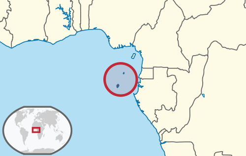
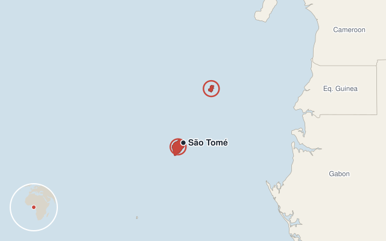

---
id    = "47c004da-41cf-52bc-8545-37ae3c45dc8c"
model = "Basic"
tags  = ["africa", "sovereign_state", "map"]
---

## Front

What is highlighted on this map?

## Back

<b>São Tomé and Príncipe</b>

## Extra

<a href="https://en.wikipedia.org/wiki/S%C3%A3o_Tom%C3%A9_and_Pr%C3%ADncipe">São Tomé and Príncipe on Wikipedia</a>
