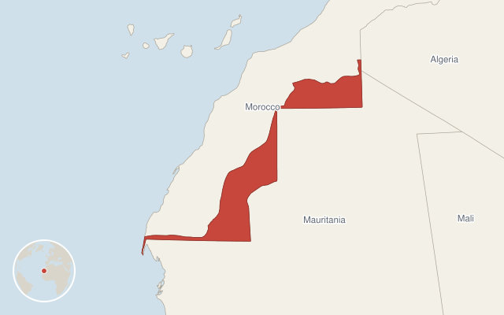

---
id    = "b458f4c6-f084-574e-882b-65c223063132"
model = "Basic"
tags  = ["africa", "sovereign_state", "capital"]
---

## Front

What is the capital of <b>Sahrawi Arab Democratic Republic</b>?

## Back

<b>Laayoune</b>

## Extra

While Laayoune, also known as El Aaiún, is the declared capital, Tifariti is the de facto seat of government.  Partially recognised state claimed by Morocco. Also known as Western Sahara.

<a href="https://en.wikipedia.org/wiki/Laayoune">Laayoune on Wikipedia</a> <a href="https://en.wikipedia.org/wiki/Western_Sahara">Western Sahara on Wikipedia</a>
