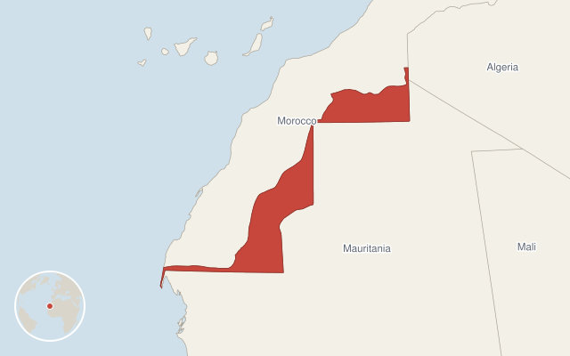

---
id    = "794e3967-d578-5a9c-8166-bef0044d2427"
model = "Basic"
tags  = ["africa", "sovereign_state", "country"]
---

## Front

<b>Laayoune</b> is the capital of which country or territory?

## Back

<b>Sahrawi Arab Democratic Republic</b>

## Extra

Partially recognised state claimed by Morocco. Also known as Western Sahara.  While Laayoune, also known as El Aaiún, is the declared capital, Tifariti is the de facto seat of government.

<a href="https://en.wikipedia.org/wiki/Western_Sahara">Western Sahara on Wikipedia</a> <a href="https://en.wikipedia.org/wiki/Laayoune">Laayoune on Wikipedia</a>
