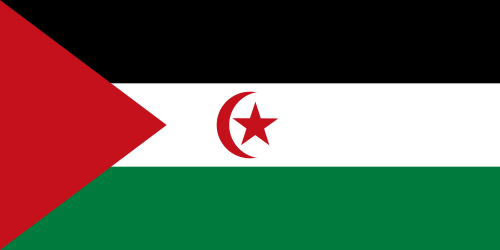

---
id    = "7a4d14b9-5c14-5335-a707-c96d77435a94"
model = "Basic"
tags  = ["africa", "sovereign_state", "flag"]
---

## Front

Whose flag is this?

## Back

<b>Sahrawi Arab Democratic Republic</b>

## Extra

Similar flags: Palestine (no symbol)  Partially recognised state claimed by Morocco. Also known as Western Sahara.
