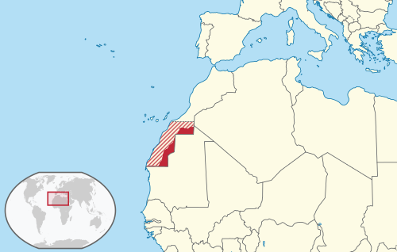
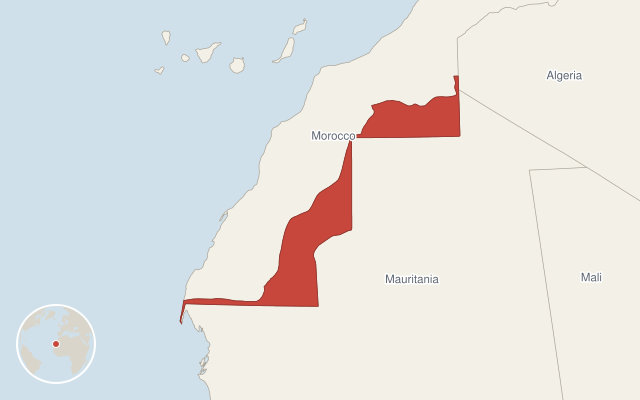
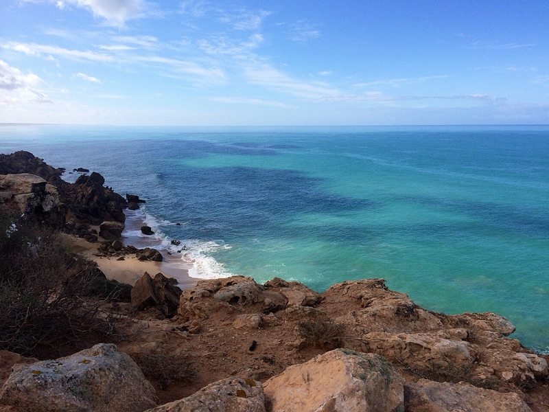

---
id    = "5795203b-958c-5a6c-9393-00090802ed7a"
model = "Basic"
tags  = ["africa", "sovereign_state", "map"]
---

## Front

What is highlighted on this map?

## Back

<b>Sahrawi Arab Democratic Republic</b>

## Extra

<i>Photo: Darymaister, CC BY-SA 4.0, via Wikimedia Commons</i>

Borders Morocco, Mauritania and Algeria About 272,000 km2

It lies in north-western Africa and consists mainly of desert flatlands.

Partially recognised state claimed by Morocco. Also known as Western Sahara.

<a href="https://en.wikipedia.org/wiki/Western_Sahara">Western Sahara on Wikipedia</a>
