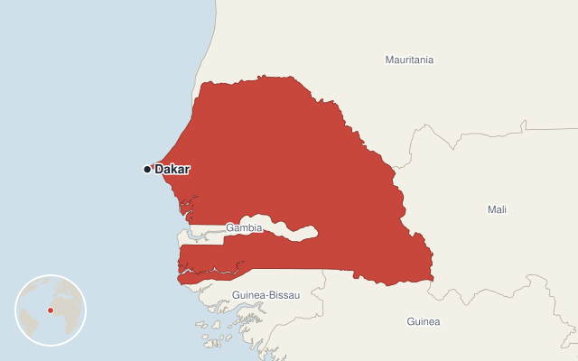

---
id    = "65a15aac-51ea-5180-867d-4f07b4491bed"
model = "Basic"
tags  = ["africa", "sovereign_state", "west_africa", "capital"]
---

## Front

What is the capital of <b>Senegal</b>?

## Back

<b>Dakar</b>

## Extra

<a href="https://en.wikipedia.org/wiki/Dakar">Dakar on Wikipedia</a> <a href="https://en.wikipedia.org/wiki/Senegal">Senegal on Wikipedia</a>
