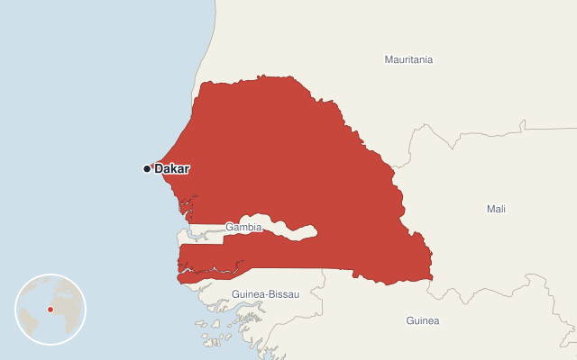

---
id    = "c12fa7de-4a97-5971-ab01-48478af0b1f6"
model = "Basic"
tags  = ["africa", "sovereign_state", "west_africa", "country"]
---

## Front

<b>Dakar</b> is the capital of which country or territory?

## Back

<b>Senegal</b>

## Extra

<a href="https://en.wikipedia.org/wiki/Senegal">Senegal on Wikipedia</a> <a href="https://en.wikipedia.org/wiki/Dakar">Dakar on Wikipedia</a>
