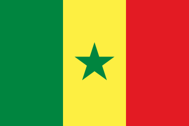
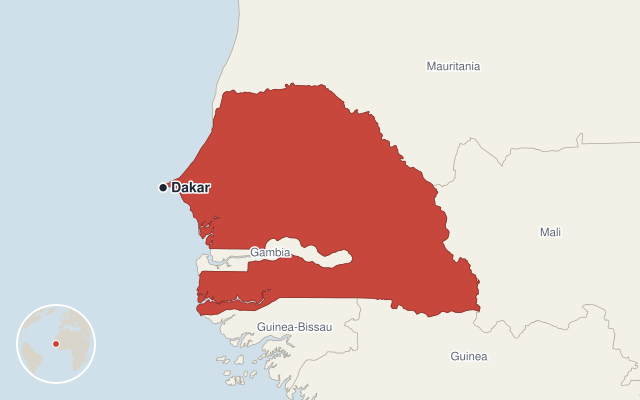

---
id    = "828dca66-4436-5cc5-a1b5-b8e73eacf91e"
model = "Basic"
tags  = ["africa", "sovereign_state", "west_africa", "flag"]
---

## Front

Whose flag is this?

## Back

<b>Senegal</b>

## Extra

Adopted in 1960, replacing the flag of the Mali Federation

The present and previous flags were inspired by the French tricolour, which flew over Senegal until 1960.

Similar flags: Cameroon (green/red/yellow, yellow star)

<a href="https://en.wikipedia.org/wiki/Flag_of_Senegal">Flag of Senegal on Wikipedia</a> <a href="https://en.wikipedia.org/wiki/Senegal">Senegal on Wikipedia</a>
