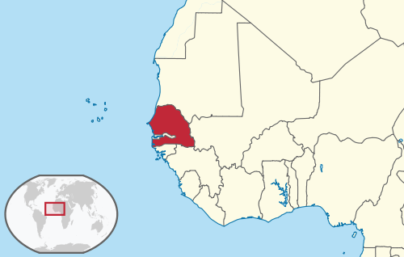
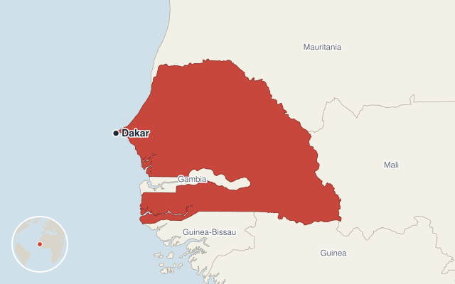

---
id    = "1f17fe35-1ec3-5738-a56b-c4c97bd0689e"
model = "Basic"
tags  = ["africa", "sovereign_state", "west_africa", "map"]
---

## Front

What is highlighted on this map?

## Back

<b>Senegal</b>

## Extra

<a href="https://en.wikipedia.org/wiki/Senegal">Senegal on Wikipedia</a>
