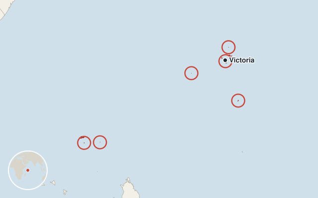
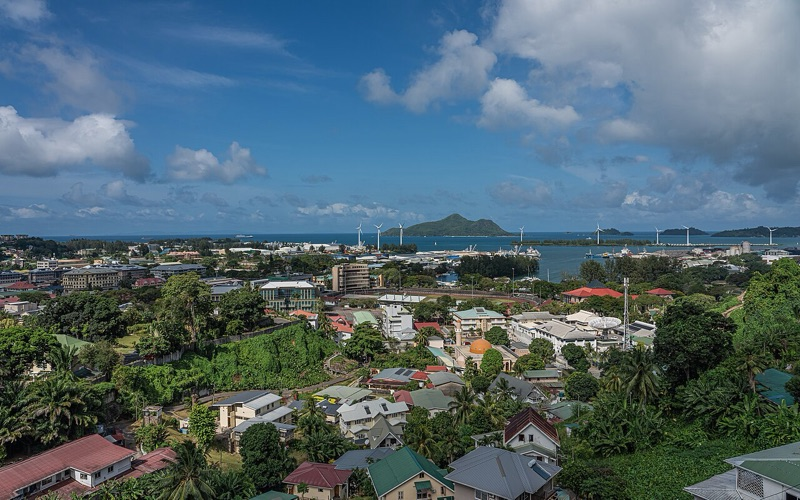

---
id    = "9ce65534-dff1-5de7-8499-119855b873d7"
model = "Basic"
tags  = ["africa", "east_africa", "sovereign_state", "capital"]
---

## Front

What is the capital of <b>Seychelles</b>?

## Back

<b>Victoria</b>

## Extra

<i>Photo: A.Savin, FAL, via Wikimedia Commons</i>

About 24,700 people (2014) On the north-eastern side of Mahé, the main island

First established as the seat of the British colonial government. Its port is known as Port Victoria.

<a href="https://en.wikipedia.org/wiki/Victoria,_Seychelles">Victoria, Seychelles on Wikipedia</a> <a href="https://en.wikipedia.org/wiki/Seychelles">Seychelles on Wikipedia</a>
