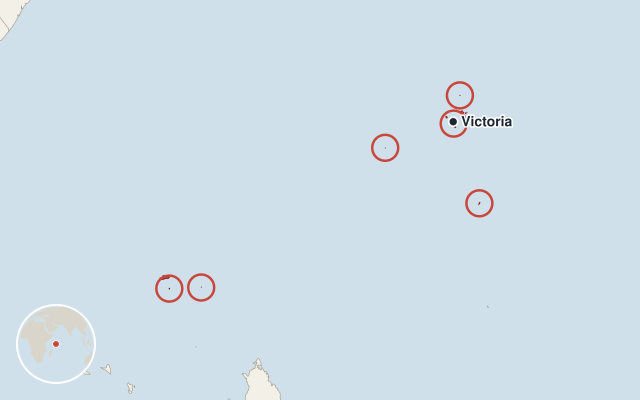
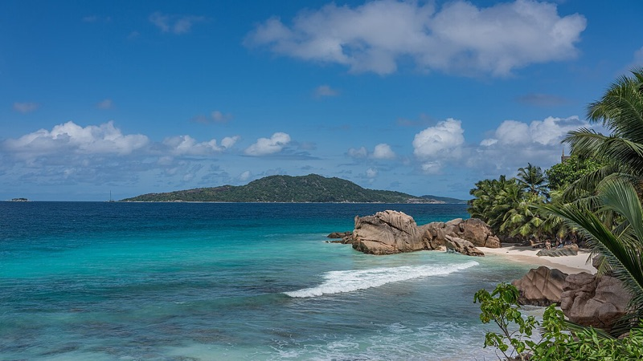

---
id    = "29f4d5f1-b46e-5623-a99e-5e74a79662b0"
model = "Basic"
tags  = ["africa", "east_africa", "sovereign_state", "country"]
---

## Front

<b>Victoria</b> is the capital of which country or territory?

## Back

<b>Seychelles</b>

## Extra

<i>Photo: A.Savin, FAL, via Wikimedia Commons</i>

About 100,600 people (2022), the least populated sovereign African country Highest point: Morne Seychellois

The smallest country in Africa, yet it has the highest nominal per capita GDP and Human Development Index ranking of any African country.

<a href="https://en.wikipedia.org/wiki/Seychelles">Seychelles on Wikipedia</a> <a href="https://en.wikipedia.org/wiki/Victoria,_Seychelles">Victoria, Seychelles on Wikipedia</a>
