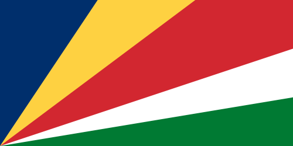
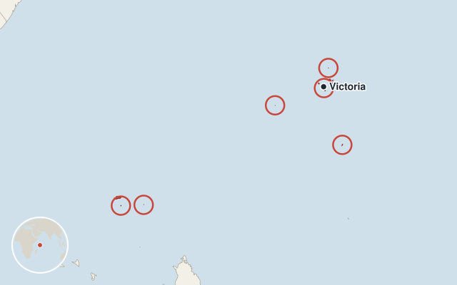

---
id    = "f7fa03f9-3973-56ff-b4d3-5443cb05d2ed"
model = "Basic"
tags  = ["africa", "east_africa", "sovereign_state", "flag"]
---

## Front

Whose flag is this?

## Back

<b>Seychelles</b>

## Extra

<a href="https://en.wikipedia.org/wiki/Flag_of_Seychelles">Flag of Seychelles on Wikipedia</a> <a href="https://en.wikipedia.org/wiki/Seychelles">Seychelles on Wikipedia</a>
