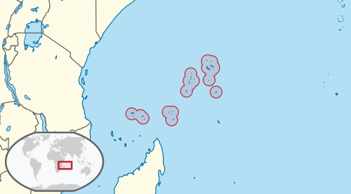

---
id    = "be48c410-dcf5-5db8-a58e-113a39d91a24"
model = "Basic"
tags  = ["africa", "east_africa", "sovereign_state", "map"]
---

## Front

What is highlighted on this map?

## Back

<b>Seychelles</b>
