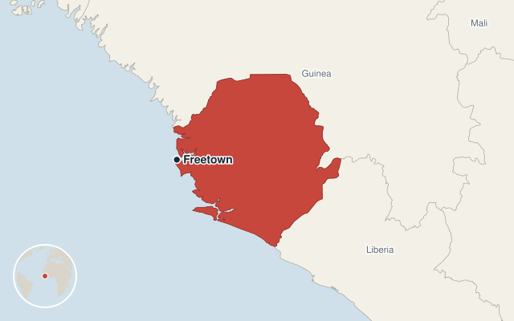

---
id    = "6d2d667f-4d59-5680-8672-c720ec49d866"
model = "Basic"
tags  = ["africa", "sovereign_state", "west_africa", "capital"]
---

## Front

What is the capital of <b>Sierra Leone</b>?

## Back

<b>Freetown</b>

## Extra

<a href="https://en.wikipedia.org/wiki/Freetown">Freetown on Wikipedia</a> <a href="https://en.wikipedia.org/wiki/Sierra_Leone">Sierra Leone on Wikipedia</a>
