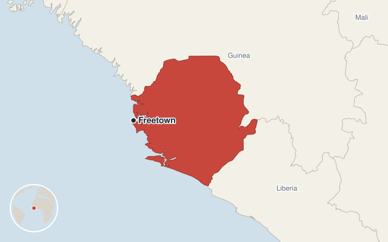

---
id    = "28bc4c8c-8c7d-5ccd-a6a9-708c4f6c1d2c"
model = "Basic"
tags  = ["africa", "sovereign_state", "west_africa", "country"]
---

## Front

<b>Freetown</b> is the capital of which country or territory?

## Back

<b>Sierra Leone</b>

## Extra

About 7.6 million people (2017) Highest point: Mount Bintumani

The name derives from the Lion Mountains near the capital, Freetown.

<a href="https://en.wikipedia.org/wiki/Sierra_Leone">Sierra Leone on Wikipedia</a> <a href="https://en.wikipedia.org/wiki/Freetown">Freetown on Wikipedia</a>
