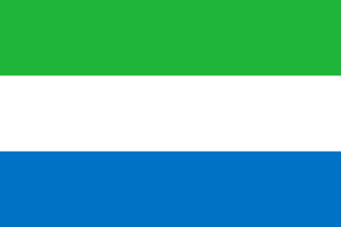
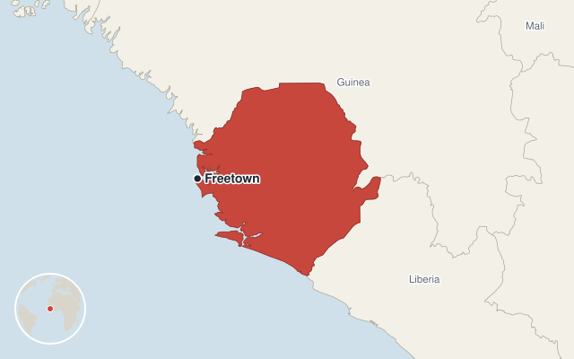

---
id    = "a3212b40-eb09-5ef9-8db3-e4ce0926686e"
model = "Basic"
tags  = ["africa", "sovereign_state", "west_africa", "flag"]
---

## Front

Whose flag is this?

## Back

<b>Sierra Leone</b>

## Extra

<a href="https://en.wikipedia.org/wiki/Flag_of_Sierra_Leone">Flag of Sierra Leone on Wikipedia</a> <a href="https://en.wikipedia.org/wiki/Sierra_Leone">Sierra Leone on Wikipedia</a>
