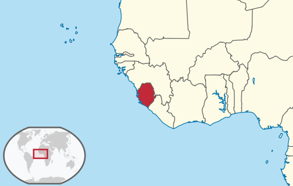
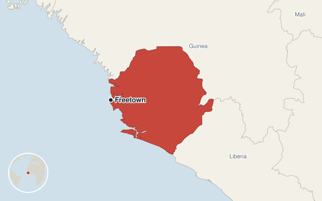

---
id    = "582b9d46-93d9-5c4e-883a-05558566f22a"
model = "Basic"
tags  = ["africa", "sovereign_state", "west_africa", "map"]
---

## Front

What is highlighted on this map?

## Back

<b>Sierra Leone</b>

## Extra

Borders Liberia and Guinea Land area 73,252 km2

A tropical country on the west coast of West Africa, with environments ranging from savannahs to rainforests.

<a href="https://en.wikipedia.org/wiki/Sierra_Leone">Sierra Leone on Wikipedia</a>
