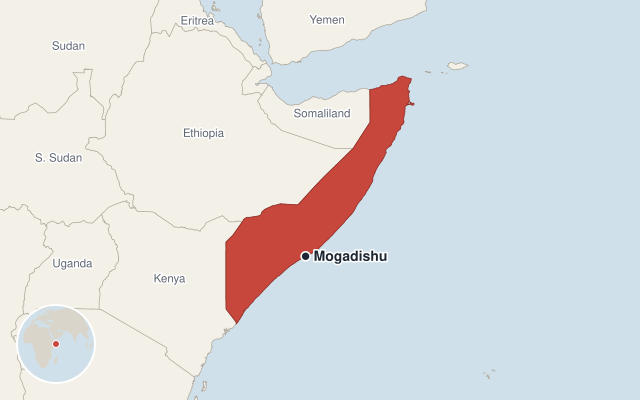

---
id    = "4901785d-de91-5ab3-92b8-29ad8b87ee4c"
model = "Basic"
tags  = ["africa", "east_africa", "sovereign_state", "capital"]
---

## Front

What is the capital of <b>Somalia</b>?

## Back

<b>Mogadishu</b>

## Extra

<a href="https://en.wikipedia.org/wiki/Mogadishu">Mogadishu on Wikipedia</a> <a href="https://en.wikipedia.org/wiki/Somalia">Somalia on Wikipedia</a>
