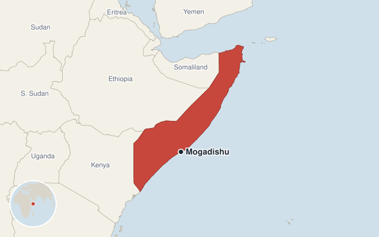

---
id    = "f7726513-54dc-5ae5-b7b6-ec26464f2177"
model = "Basic"
tags  = ["africa", "east_africa", "sovereign_state", "country"]
---

## Front

<b>Mogadishu</b> is the capital of which country or territory?

## Back

<b>Somalia</b>

## Extra

<a href="https://en.wikipedia.org/wiki/Somalia">Somalia on Wikipedia</a> <a href="https://en.wikipedia.org/wiki/Mogadishu">Mogadishu on Wikipedia</a>
