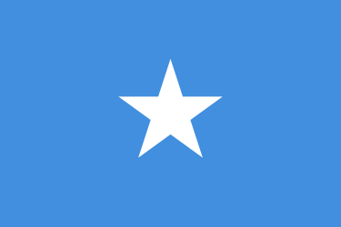
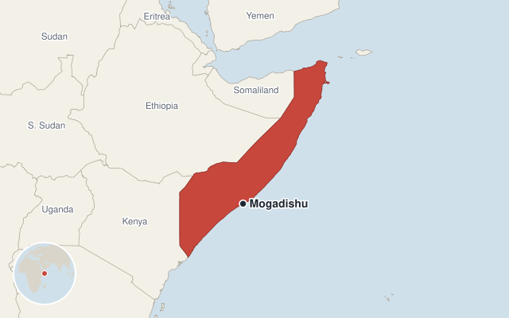

---
id    = "0823e761-e1f3-570a-a55b-be5dc0b2bfb8"
model = "Basic"
tags  = ["africa", "east_africa", "sovereign_state", "flag"]
---

## Front

Whose flag is this?

## Back

<b>Somalia</b>

## Extra

<a href="https://en.wikipedia.org/wiki/Flag_of_Somalia">Flag of Somalia on Wikipedia</a> <a href="https://en.wikipedia.org/wiki/Somalia">Somalia on Wikipedia</a>
