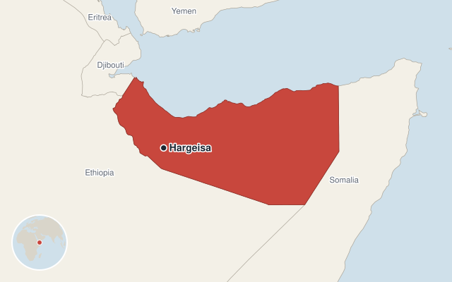
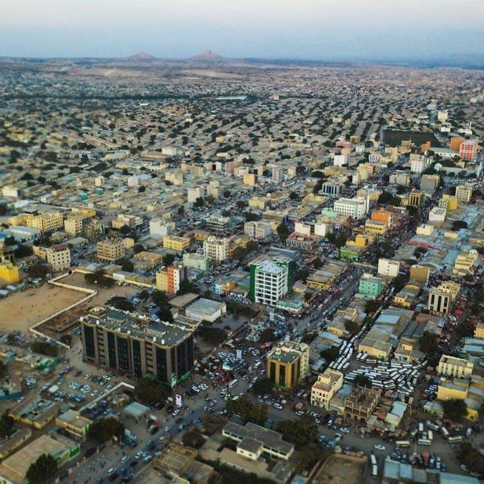

---
id    = "829509cc-375c-531c-8093-e787280f2dc3"
model = "Basic"
tags  = ["africa", "east_africa", "sovereign_state", "capital"]
---

## Front

What is the capital of <b>Somaliland</b>?

## Back

<b>Hargeisa</b>

## Extra

<i>Photo: Somaliland.com, Public domain, via Wikimedia Commons</i>

About 1.23 million people (2025) 1,260 m up

Capital of a partially recognised state that is still considered internationally part of Somalia. It was founded as a watering and trading stop between the coast and the interior.

Independent state claimed by Somalia.

<a href="https://en.wikipedia.org/wiki/Hargeisa">Hargeisa on Wikipedia</a> <a href="https://en.wikipedia.org/wiki/Somaliland">Somaliland on Wikipedia</a>
