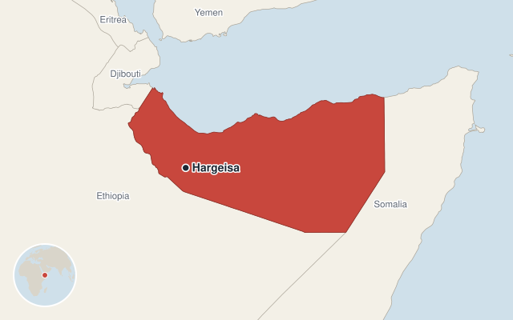

---
id    = "4398a553-1afd-5c21-8c31-59b00e1b4d6b"
model = "Basic"
tags  = ["africa", "east_africa", "sovereign_state", "country"]
---

## Front

<b>Hargeisa</b> is the capital of which country or territory?

## Back

<b>Somaliland</b>

## Extra

Independent state claimed by Somalia.

<a href="https://en.wikipedia.org/wiki/Somaliland">Somaliland on Wikipedia</a> <a href="https://en.wikipedia.org/wiki/Hargeisa">Hargeisa on Wikipedia</a>
