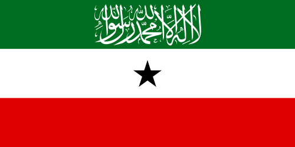
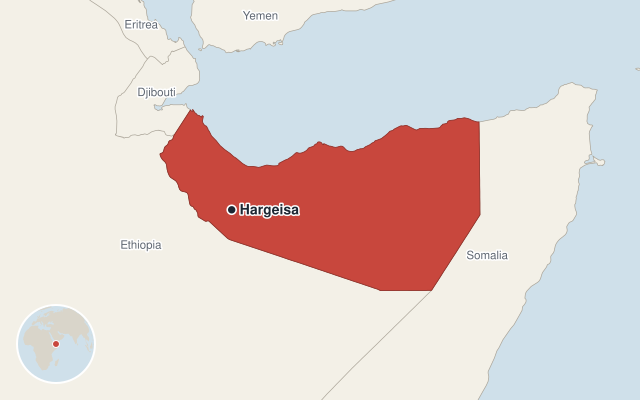

---
id    = "56f54e4e-35d1-57d8-9007-a88180b7158d"
model = "Basic"
tags  = ["africa", "east_africa", "sovereign_state", "flag"]
---

## Front

Whose flag is this?

## Back

<b>Somaliland</b>

## Extra

Adopted on 15 October 1996

Green carries the Shahada in white script, white carries a black star for peace, purity and unity, and red stands for the struggle for independence.

Independent state claimed by Somalia.

<a href="https://en.wikipedia.org/wiki/Flag_of_Somaliland">Flag of Somaliland on Wikipedia</a> <a href="https://en.wikipedia.org/wiki/Somaliland">Somaliland on Wikipedia</a>
