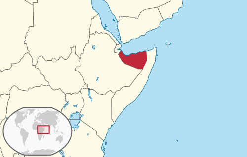
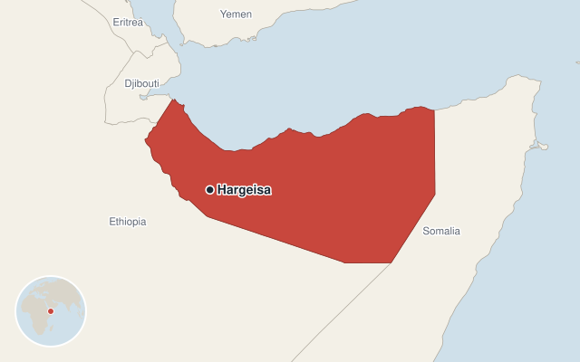

---
id    = "9c1ac2a4-29ad-58a1-b510-fc2527ce99cf"
model = "Basic"
tags  = ["africa", "east_africa", "sovereign_state", "map"]
---

## Front

What is highlighted on this map?

## Back

<b>Somaliland</b>

## Extra

Borders Djibouti, Ethiopia and Somalia On the southern coast of the Gulf of Aden

The Somaliland Protectorate gained independence from the United Kingdom in 1960 and united days later with the former Italian Somaliland to form the Somali Republic.

Independent state claimed by Somalia.

<a href="https://en.wikipedia.org/wiki/Somaliland">Somaliland on Wikipedia</a>
