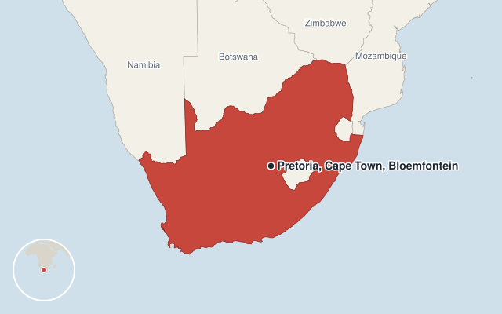
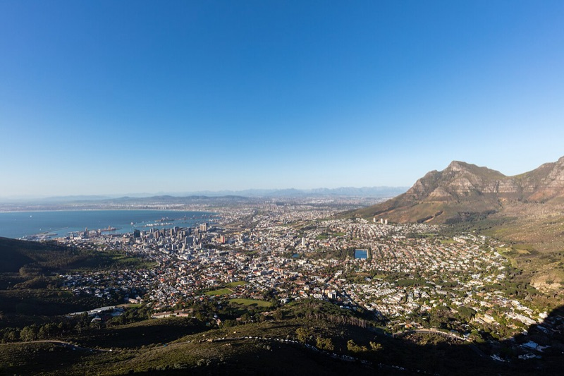

---
id    = "ccfac4d5-f2da-52d2-8764-eb46f6b7cbc7"
model = "Basic"
tags  = ["africa", "sovereign_state", "capital"]
---

## Front

What is the capital of <b>South Africa</b>?

## Back

<b>Pretoria, Cape Town, Bloemfontein</b>

## Extra

<i>Photo: Diego Delso, Diego Delso, via Wikimedia Commons</i>

Pretoria is the executive capital and hosts all foreign embassies Cape Town is the legislative capital, Bloemfontein the judicial capital

Cape Town, the country's oldest city, is the seat of Parliament. The Constitutional Court, the highest court, has been in Johannesburg since 1994, not in Bloemfontein.

South Africa has no legally defined capital: the branches of government are split over three cities: Pretoria (executive), Cape Town (legislative) and Bloemfontein (judicial).

<a href="https://en.wikipedia.org/wiki/Pretoria">Pretoria on Wikipedia</a> <a href="https://en.wikipedia.org/wiki/Cape_Town">Cape Town on Wikipedia</a> <a href="https://en.wikipedia.org/wiki/Bloemfontein">Bloemfontein on Wikipedia</a> <a href="https://en.wikipedia.org/wiki/South_Africa">South Africa on Wikipedia</a>
