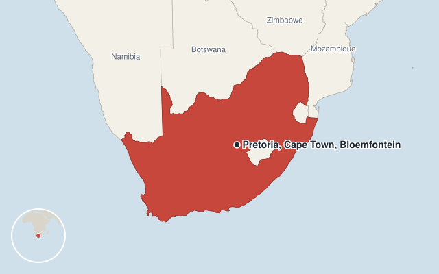

---
id    = "cb404660-61f1-559a-96dd-ba932ee64c6e"
model = "Basic"
tags  = ["africa", "sovereign_state", "country"]
---

## Front

<b>Pretoria, Cape Town, Bloemfontein</b> is the capital of which country or territory?

## Back

<b>South Africa</b>

## Extra

South Africa has no legally defined capital: the branches of government are split over three cities: Pretoria (executive), Cape Town (legislative) and Bloemfontein (judicial).

<a href="https://en.wikipedia.org/wiki/South_Africa">South Africa on Wikipedia</a> <a href="https://en.wikipedia.org/wiki/Pretoria">Pretoria on Wikipedia</a> <a href="https://en.wikipedia.org/wiki/Cape_Town">Cape Town on Wikipedia</a> <a href="https://en.wikipedia.org/wiki/Bloemfontein">Bloemfontein on Wikipedia</a>
