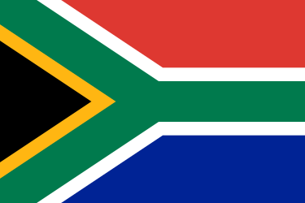
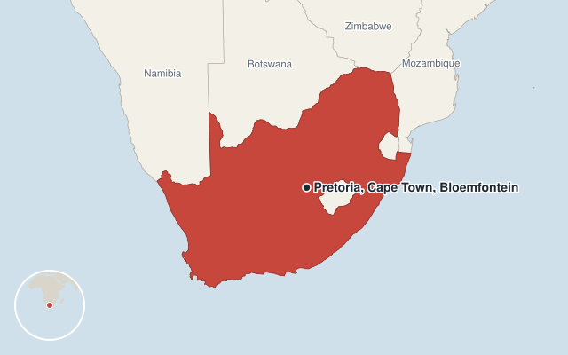

---
id    = "e9dab007-aef3-509c-bef2-9b5ee75543b3"
model = "Basic"
tags  = ["africa", "sovereign_state", "flag"]
---

## Front

Whose flag is this?

## Back

<b>South Africa</b>

## Extra

<a href="https://en.wikipedia.org/wiki/Flag_of_South_Africa">Flag of South Africa on Wikipedia</a> <a href="https://en.wikipedia.org/wiki/South_Africa">South Africa on Wikipedia</a>
