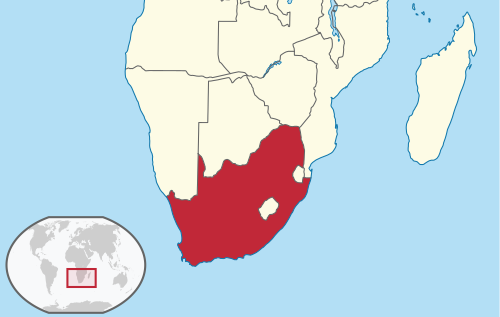
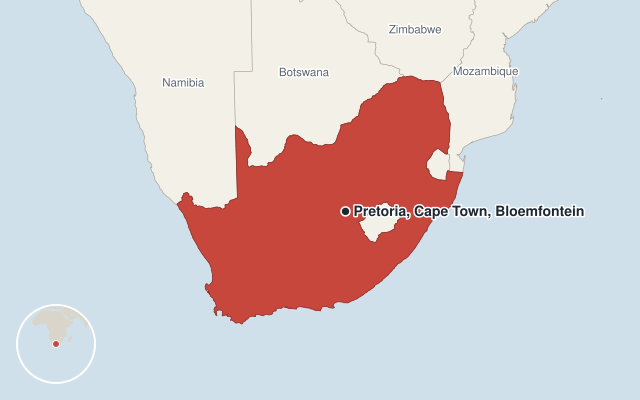

---
id    = "5c3a41b7-64d6-5e17-9a26-0495e0af496a"
model = "Basic"
tags  = ["africa", "sovereign_state", "map"]
---

## Front

What is highlighted on this map?

## Back

<b>South Africa</b>

## Extra

Borders Namibia, Botswana, Zimbabwe, Mozambique and Eswatini About 1.22 million km2, in nine provinces

South Africa encloses Lesotho entirely, so that country appears as a hole in its map.

<a href="https://en.wikipedia.org/wiki/South_Africa">South Africa on Wikipedia</a>
