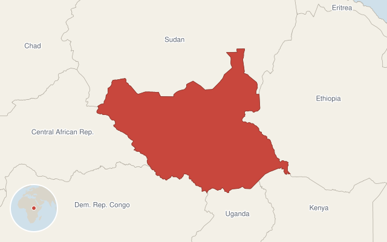

---
id    = "f7bd944b-18a9-5e9f-ba6e-dbe0331ea453"
model = "Basic"
tags  = ["africa", "east_africa", "sovereign_state", "capital"]
---

## Front

What is the capital of <b>South Sudan</b>?

## Back

<b>Juba</b>

## Extra

About 500,000 people (2025) On the White Nile, also capital of Central Equatoria State

The city was made the capital of Mongalla Province in the late 1920s.

<a href="https://en.wikipedia.org/wiki/Juba">Juba on Wikipedia</a> <a href="https://en.wikipedia.org/wiki/South_Sudan">South Sudan on Wikipedia</a>
