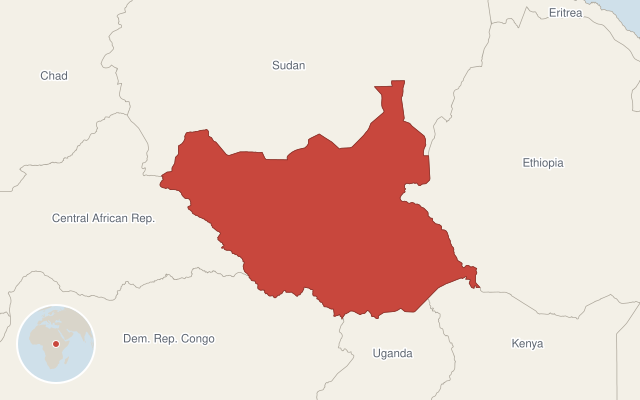

---
id    = "aa81e1b2-acb8-5048-9d4b-0cfe5ae7db60"
model = "Basic"
tags  = ["africa", "east_africa", "sovereign_state", "country"]
---

## Front

<b>Juba</b> is the capital of which country or territory?

## Back

<b>South Sudan</b>

## Extra

<a href="https://en.wikipedia.org/wiki/South_Sudan">South Sudan on Wikipedia</a> <a href="https://en.wikipedia.org/wiki/Juba">Juba on Wikipedia</a>
