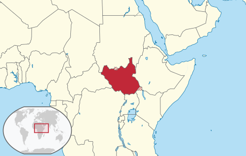
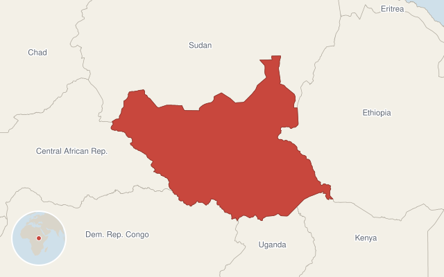

---
id    = "6af6cbf1-9efa-52a6-8842-4308ad2f30b8"
model = "Basic"
tags  = ["africa", "east_africa", "sovereign_state", "map"]
---

## Front

What is highlighted on this map?

## Back

<b>South Sudan</b>

## Extra

<a href="https://en.wikipedia.org/wiki/South_Sudan">South Sudan on Wikipedia</a>
