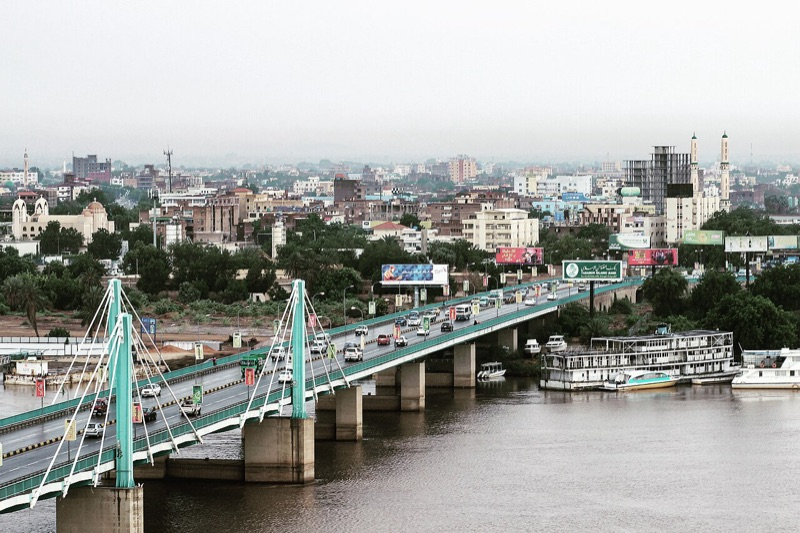

---
id    = "31692a78-a138-5627-8461-58a511f9ffc5"
model = "Basic"
tags  = ["africa", "sovereign_state", "capital"]
---

## Front

What is the capital of <b>Sudan</b>?

## Back

<b>Khartoum</b>

## Extra

<i>Photo: Arwa51o, CC BY-SA 4.0, via Wikimedia Commons</i>

Metropolitan area of about 5.3 million people (2018) At the confluence of the White Nile and the Blue Nile

Founded in 1821 by Muhammad Ali Pasha, north of the ancient city of Soba. Bridges link Khartoum proper to Khartoum North and Omdurman.

<a href="https://en.wikipedia.org/wiki/Khartoum">Khartoum on Wikipedia</a> <a href="https://en.wikipedia.org/wiki/Sudan">Sudan on Wikipedia</a>
