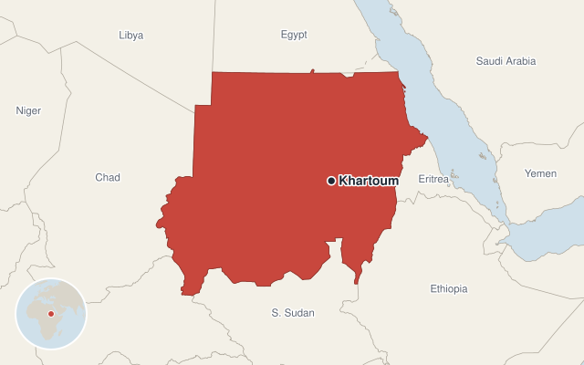

---
id    = "31692a78-a138-5627-8461-58a511f9ffc5"
model = "Basic"
tags  = ["africa", "sovereign_state", "capital"]
---

## Front

What is the capital of <b>Sudan</b>?

## Back

<b>Khartoum</b>

## Extra

<a href="https://en.wikipedia.org/wiki/Khartoum">Khartoum on Wikipedia</a> <a href="https://en.wikipedia.org/wiki/Sudan">Sudan on Wikipedia</a>
