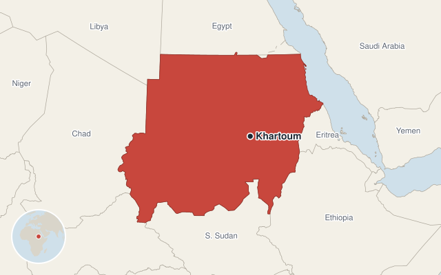

---
id    = "ea869487-0dd1-57a7-a11a-8753095d20f2"
model = "Basic"
tags  = ["africa", "sovereign_state", "country"]
---

## Front

<b>Khartoum</b> is the capital of which country or territory?

## Back

<b>Sudan</b>

## Extra

<a href="https://en.wikipedia.org/wiki/Sudan">Sudan on Wikipedia</a> <a href="https://en.wikipedia.org/wiki/Khartoum">Khartoum on Wikipedia</a>
