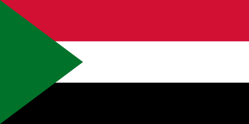
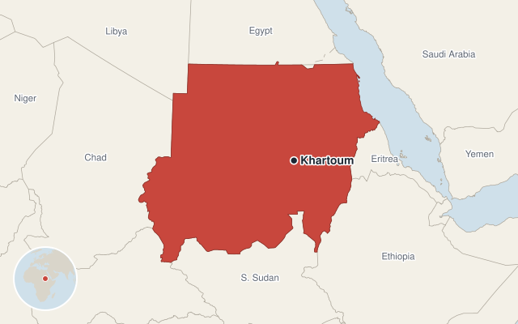

---
id    = "93c040e9-8dd0-501d-852d-e8b93db6b659"
model = "Basic"
tags  = ["africa", "sovereign_state", "flag"]
---

## Front

Whose flag is this?

## Back

<b>Sudan</b>

## Extra

Adopted on 20 May 1970

A red-white-black tricolour with a green triangle, based on the Arab Liberation Flag of the Egyptian Revolution of 1952. It replaced a blue-yellow-green flag after the 1969 coup.

Similar flags: Palestine (black/white/green, red arrow)

<a href="https://en.wikipedia.org/wiki/Flag_of_Sudan">Flag of Sudan on Wikipedia</a> <a href="https://en.wikipedia.org/wiki/Sudan">Sudan on Wikipedia</a>
