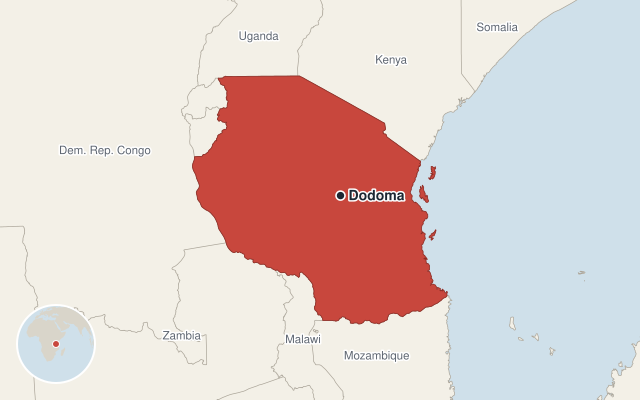

---
id    = "eb41c3a5-b0ad-5571-9146-494d43864114"
model = "Basic"
tags  = ["africa", "east_africa", "sovereign_state", "capital"]
---

## Front

What is the capital of <b>Tanzania</b>?

## Back

<b>Dodoma</b>

## Extra

While Dodoma is the official capital, Dar es Salaam is the de facto seat of government.

<a href="https://en.wikipedia.org/wiki/Dodoma">Dodoma on Wikipedia</a> <a href="https://en.wikipedia.org/wiki/Tanzania">Tanzania on Wikipedia</a>
