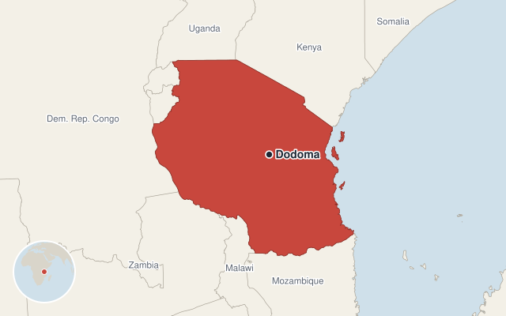

---
id    = "f8ee1d6d-5af0-5583-ab33-650fccea6315"
model = "Basic"
tags  = ["africa", "east_africa", "sovereign_state", "country"]
---

## Front

<b>Dodoma</b> is the capital of which country or territory?

## Back

<b>Tanzania</b>

## Extra

While Dodoma is the official capital, Dar es Salaam is the de facto seat of government.

<a href="https://en.wikipedia.org/wiki/Tanzania">Tanzania on Wikipedia</a> <a href="https://en.wikipedia.org/wiki/Dodoma">Dodoma on Wikipedia</a>
