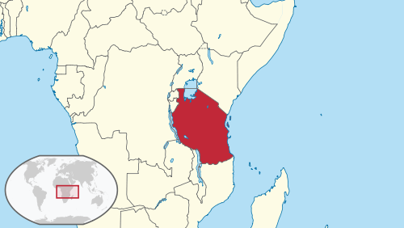
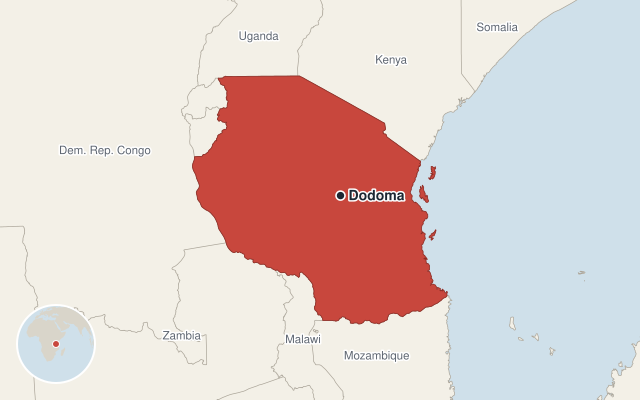

---
id    = "000fe3d4-3b61-5ee6-bf92-b63c08381c7d"
model = "Basic"
tags  = ["africa", "east_africa", "sovereign_state", "map"]
---

## Front

What is highlighted on this map?

## Back

<b>Tanzania</b>

## Extra

Borders Uganda, Kenya, Mozambique, Malawi, Zambia, Rwanda, Burundi and the DR Congo About 947,000 km2, with the Indian Ocean to the east

It lies in the African Great Lakes region, in East Africa.

<a href="https://en.wikipedia.org/wiki/Tanzania">Tanzania on Wikipedia</a>
