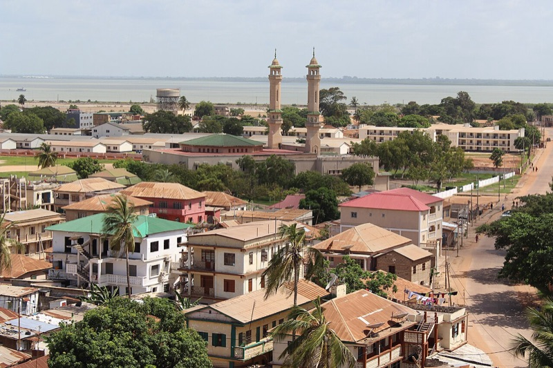

---
id    = "1c719437-c41b-5d8a-b1cc-1261fb8d2a44"
model = "Basic"
tags  = ["africa", "sovereign_state", "west_africa", "capital"]
---

## Front

What is the capital of <b>The Gambia</b>?

## Back

<b>Banjul</b>

## Extra

<i>Photo: IsaacTuray, CC0, via Wikimedia Commons</i>

About 26,500 people in the city proper, 405,809 in Greater Banjul (2024 census) On St Mary's Island, where the Gambia River enters the Atlantic

From the 19th century until 24 April 1973 the city was known as Bathurst. Bridges link the island to the mainland.

<a href="https://en.wikipedia.org/wiki/Banjul">Banjul on Wikipedia</a> <a href="https://en.wikipedia.org/wiki/The_Gambia">The Gambia on Wikipedia</a>
