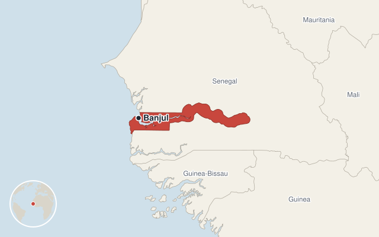

---
id    = "1c719437-c41b-5d8a-b1cc-1261fb8d2a44"
model = "Basic"
tags  = ["africa", "sovereign_state", "west_africa", "capital"]
---

## Front

What is the capital of <b>The Gambia</b>?

## Back

<b>Banjul</b>

## Extra

<a href="https://en.wikipedia.org/wiki/Banjul">Banjul on Wikipedia</a> <a href="https://en.wikipedia.org/wiki/The_Gambia">The Gambia on Wikipedia</a>
