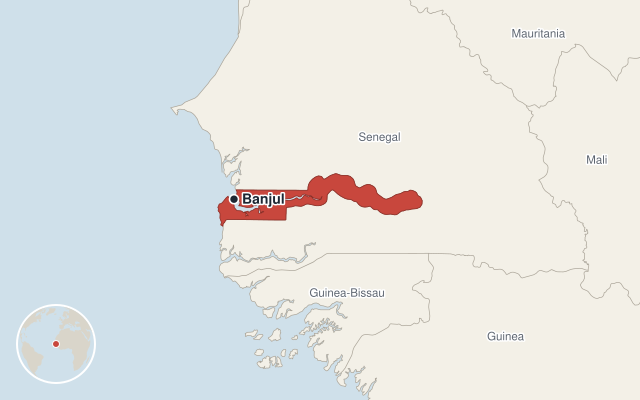

---
id    = "01c62019-7673-5bbe-92a9-c1df871ce833"
model = "Basic"
tags  = ["africa", "sovereign_state", "west_africa", "country"]
---

## Front

<b>Banjul</b> is the capital of which country or territory?

## Back

<b>The Gambia</b>

## Extra

About 2.4 million people (2024 census) The smallest country in continental Africa

Its elongated shape follows the Gambia River, which flows through the centre of the country and empties into the Atlantic.

<a href="https://en.wikipedia.org/wiki/The_Gambia">The Gambia on Wikipedia</a> <a href="https://en.wikipedia.org/wiki/Banjul">Banjul on Wikipedia</a>
