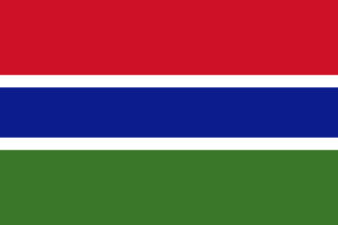
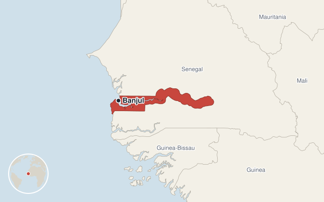

---
id    = "5a7ae6d7-883a-55ad-862e-7db91f43fe1d"
model = "Basic"
tags  = ["africa", "sovereign_state", "west_africa", "flag"]
---

## Front

Whose flag is this?

## Back

<b>The Gambia</b>

## Extra

<a href="https://en.wikipedia.org/wiki/Flag_of_the_Gambia">Flag of the Gambia on Wikipedia</a> <a href="https://en.wikipedia.org/wiki/The_Gambia">The Gambia on Wikipedia</a>
