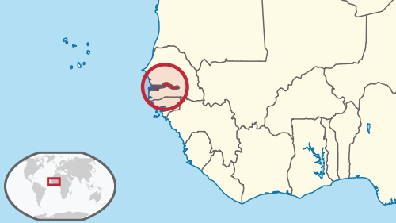
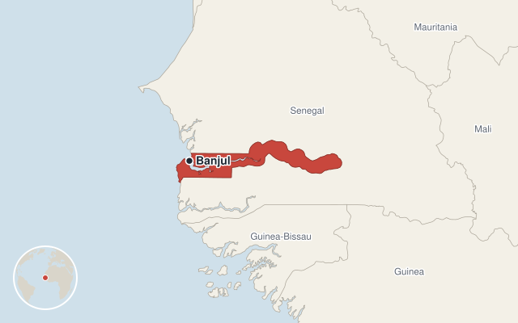

---
id    = "619deb88-45c2-557f-a219-c0bf72e8f2e8"
model = "Basic"
tags  = ["africa", "sovereign_state", "west_africa", "map"]
---

## Front

What is highlighted on this map?

## Back

<b>The Gambia</b>

## Extra

<a href="https://en.wikipedia.org/wiki/The_Gambia">The Gambia on Wikipedia</a>
