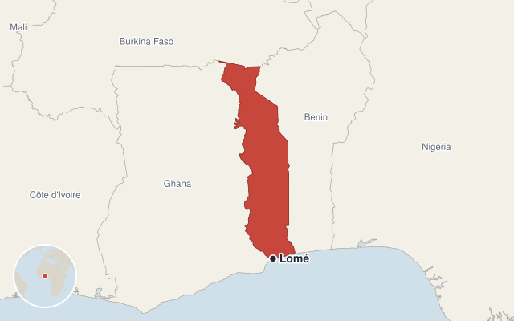
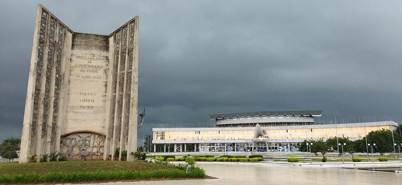

---
id    = "3236f95e-2189-5a8d-8f4a-afa4ec920dbe"
model = "Basic"
tags  = ["africa", "sovereign_state", "west_africa", "capital"]
---

## Front

What is the capital of <b>Togo</b>?

## Back

<b>Lomé</b>

## Extra

<i>Photo: Hermannkass, CC BY-SA 4.0, via Wikimedia Commons</i>

About 837,000 people in the city, 2.19 million in the metropolitan area (2022 census) On the Gulf of Guinea, at the southwest corner of the country

The city extends to the Ghana border, a few hundred metres west of the centre. It is Togo's chief port, exporting coffee, cocoa, copra and oil palm kernels.

<a href="https://en.wikipedia.org/wiki/Lom%C3%A9">Lomé on Wikipedia</a> <a href="https://en.wikipedia.org/wiki/Togo">Togo on Wikipedia</a>
