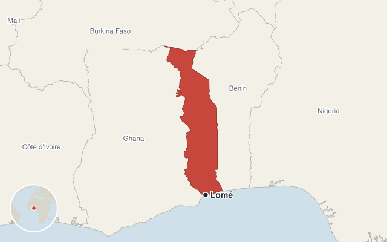

---
id    = "d8dc7e84-79bc-56c8-a5e3-d7ecc034927d"
model = "Basic"
tags  = ["africa", "sovereign_state", "west_africa", "country"]
---

## Front

<b>Lomé</b> is the capital of which country or territory?

## Back

<b>Togo</b>

## Extra

<a href="https://en.wikipedia.org/wiki/Togo">Togo on Wikipedia</a> <a href="https://en.wikipedia.org/wiki/Lom%C3%A9">Lomé on Wikipedia</a>
