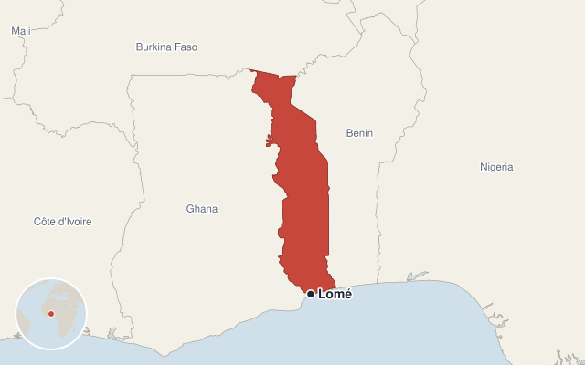

---
id    = "18c80319-a2ad-5b1b-9a86-624365aa152f"
model = "Basic"
tags  = ["africa", "sovereign_state", "west_africa", "map"]
---

## Front

What is highlighted on this map?

## Back

<b>Togo</b>

## Extra

<a href="https://en.wikipedia.org/wiki/Togo">Togo on Wikipedia</a>
