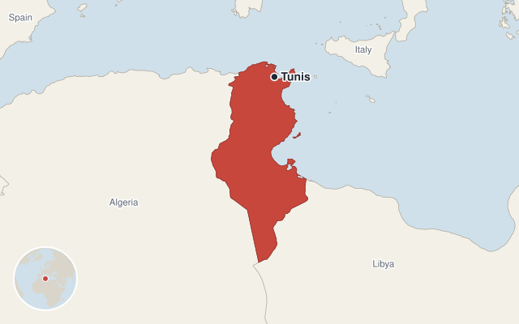
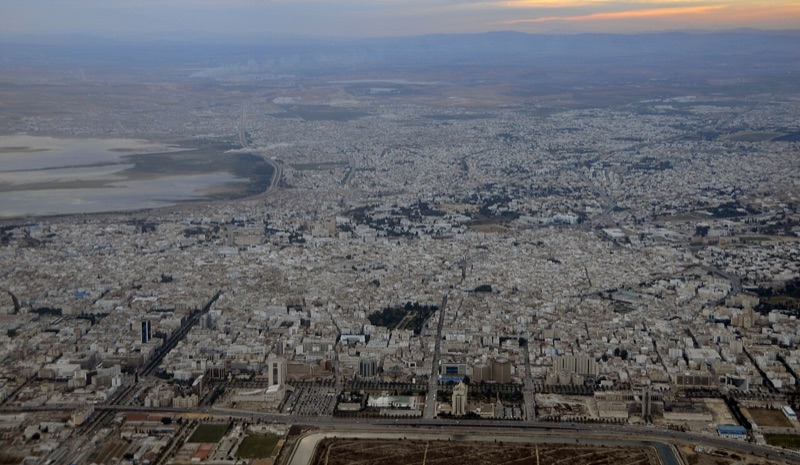

---
id    = "3d332a79-2330-5722-b524-9840a74685a0"
model = "Basic"
tags  = ["africa", "mediterranean", "sovereign_state", "capital"]
---

## Front

What is the capital of <b>Tunisia</b>?

## Back

<b>Tunis</b>

## Extra

<i>Photo: Citizen59 from Tunis, Tunisie, CC BY-SA 2.0, via Wikimedia Commons</i>

About 2.7 million people in Grand Tunis On the Gulf of Tunis, behind the Lake of Tunis

Its Medina is a World Heritage Site. East of it lies the modern Ville Nouvelle, with Avenue Habib Bourguiba, and the suburbs of Carthage and Sidi Bou Said by the sea.

<a href="https://en.wikipedia.org/wiki/Tunis">Tunis on Wikipedia</a> <a href="https://en.wikipedia.org/wiki/Tunisia">Tunisia on Wikipedia</a>
