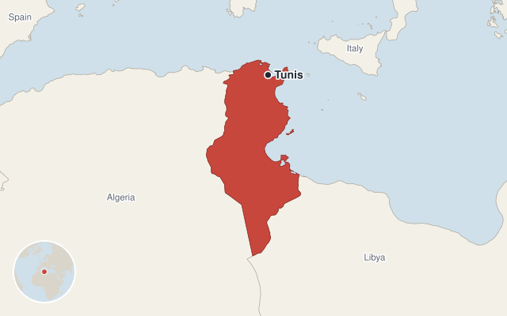

---
id    = "d1562c67-12e5-526b-be47-56f472a9bfd9"
model = "Basic"
tags  = ["africa", "mediterranean", "sovereign_state", "country"]
---

## Front

<b>Tunis</b> is the capital of which country or territory?

## Back

<b>Tunisia</b>

## Extra

<a href="https://en.wikipedia.org/wiki/Tunisia">Tunisia on Wikipedia</a> <a href="https://en.wikipedia.org/wiki/Tunis">Tunis on Wikipedia</a>
