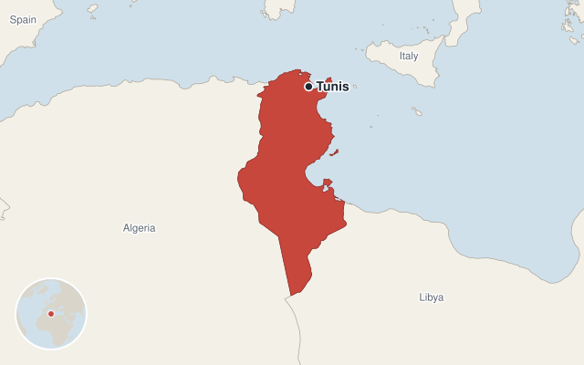

---
id    = "921d5099-23c7-530f-a048-6b6bffbf0e47"
model = "Basic"
tags  = ["africa", "mediterranean", "sovereign_state", "flag"]
---

## Front

Whose flag is this?

## Back

<b>Tunisia</b>

## Extra

Proclaimed the state flag on 1 June 1959

A red field with a white disk holding a red crescent around a red star. The crescent and star are symbols related to Ottoman rule; Hussein II created a similar flag after 1827.

<a href="https://en.wikipedia.org/wiki/Flag_of_Tunisia">Flag of Tunisia on Wikipedia</a> <a href="https://en.wikipedia.org/wiki/Tunisia">Tunisia on Wikipedia</a>
