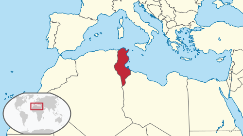
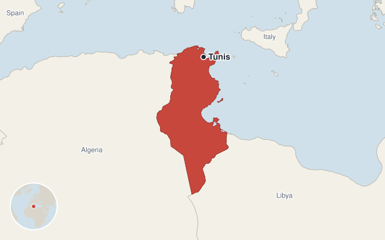

---
id    = "81cc5e1d-bed0-5488-b8c8-b74e90897dd2"
model = "Basic"
tags  = ["africa", "mediterranean", "sovereign_state", "map"]
---

## Front

What is highlighted on this map?

## Back

<b>Tunisia</b>

## Extra

Borders Algeria and Libya, with the Mediterranean to the north and east About 163,600 km2

It holds the eastern end of the Atlas Mountains and the northern reaches of the Sahara, and has 1,300 km of coastline.

<a href="https://en.wikipedia.org/wiki/Tunisia">Tunisia on Wikipedia</a>
